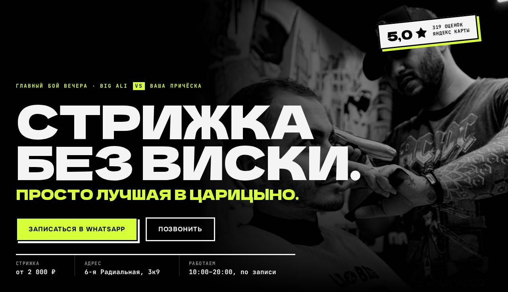
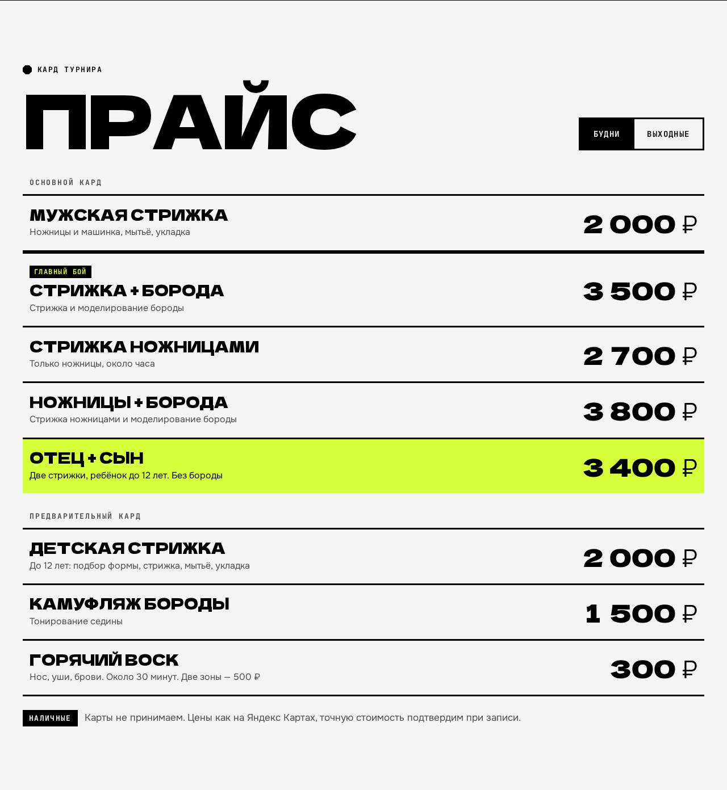

# ✂️ Big Ali's — лендинг барбершопа

**Сайт:** https://toctep-official.github.io/barber/



Неофициальный концепт сайта для барбершопа Big Ali's в Царицыно (6-я Радиальная, 3к9).
Стиль «вечер боёв»: Али увлекается UFC, поэтому сайт оформлен как афиша турнира. Прайс подан как кард боёв, мастер представлен досье бойца, отзывы показаны как решение судей, а путь до барбершопа разбит на три раунда. Цвета чёрный, белый и лаймовый взяты из логотипа сети. Логотипа и названия UFC в оформлении нет, это только отсылка к стилю.
Чистые HTML, CSS и JavaScript, без фреймворков и сборки.

## Что есть на сайте

- **Прайс с переключателем «Будни / Выходные».** Цены в выходные выше, и переключатель меняет их на месте. По субботам и воскресеньям сайт сам показывает цены выходного дня.
- **Запись в одно касание.** Посетитель выбирает услугу и удобный день, а сайт собирает готовое сообщение для WhatsApp. Для Телеграма текст копируется в буфер обмена.
- **«Отец + сын»** отдельным блоком: это редкая услуга и хороший повод прийти.
- **Отзывы цифрами.** Настоящая разбивка оценок с Яндекс Карт вместо придуманных цитат.
- **«Как найти» в три шага.** Вход неочевидный, через арку во двор. Рядом карта, способы оплаты, парковка и пандус.
- **Телефон.** Кнопки записи закреплены внизу экрана, меню открывается на весь экран, работы листаются пальцем вбок.



## Как запустить

Откройте `index.html` в браузере. Устанавливать ничего не нужно.

## Структура

```
index.html      разметка
css/style.css   стили; цвета, шрифты и обработка фото задаются переменными в начале файла
js/main.js      меню, прайс «будни / выходные», сборка сообщения для записи
img/            фото барбершопа и логотип сети «Мужские стрижки»
```

## Что заменить перед запуском

- Для блока «Отец + сын» пока нет фото. Если появится снимок отца с сыном, его можно вернуть в блок.
- Цены взяты с Яндекс Карт (там отмечено, что они давно не обновлялись).

Шрифты: Dela Gothic One, Onest, JetBrains Mono (Google Fonts).
